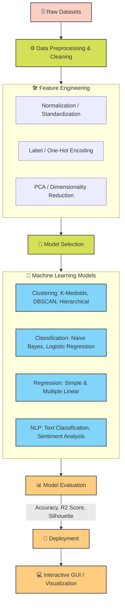

<!-- =======================================================
  🤖 DS-ML-TASKS Portfolio README
  Author: Sabarish M S
======================================================== -->

<div align="center">

  <h1>🤖 Machine Learning & Data Science Portfolio (DS-ML-TASKS)</h1>
  <p><strong>Python • Scikit-Learn • Pandas • Matplotlib • Tkinter</strong></p>

  <p>
    <a href="https://www.python.org/"></a>
    <a href="https://scikit-learn.org/"></a>
    <a href="https://pandas.pydata.org/"></a>
    <a href="https://numpy.org/"></a>
    <a href="https://matplotlib.org/"></a>
    <a href="https://seaborn.pydata.org/"></a>
    <a href="https://jupyter.org/"></a>
  </p>

  <p>
    Welcome to my <strong>Data Science and Machine Learning</strong> repository! This repository showcases structured assignments, weekly mini-projects, and end-to-end implementations covering data preprocessing, exploratory data analysis (EDA), statistical modeling, unsupervised and supervised machine learning algorithms, and desktop prediction interfaces.
  </p>

  <p>
    🌐 <strong>Portfolio:</strong> <a href="https://sabarishdev.netlify.app/">sabarishdev.netlify.app</a>
  </p>

</div>

<hr />

<h2>📖 Table of Contents</h2>

<ul>
  <li><a href="#-ml-pipeline-architecture">ML Pipeline Architecture</a></li>
  <li><a href="#-tech-stack">Tech Stack</a></li>
  <li><a href="#-project-walkthrough">Project Walkthrough</a>
    <ul>
      <li><a href="#1-unsupervised-learning--clustering">Unsupervised Learning &amp; Clustering</a></li>
      <li><a href="#2-classification--nlp">Classification &amp; NLP</a></li>
      <li><a href="#3-regression-models">Regression Models</a></li>
    </ul>
  </li>
  <li><a href="#-getting-started">Getting Started</a></li>
  <li><a href="#-repository-structure">Repository Structure</a></li>
  <li><a href="#-roadmap">Roadmap</a></li>
  <li><a href="#-license">License</a></li>
  <li><a href="#-author">Author</a></li>
  <li><a href="#-acknowledgements">Acknowledgements</a></li>
</ul>

<hr />

<h2 id="-ml-pipeline-architecture">🏗️ ML Pipeline Architecture</h2>

<p>
  The projects in this repository follow a modular Data Science lifecycle. Desktop graphical user interfaces built with Tkinter serve as prediction clients for raw parameter inputs and real-time inference.
</p>



```bash
git clone [https://github.com/SabarishMS123/DS-ML-TASKS.git](https://github.com/SabarishMS123/DS-ML-TASKS.git)
cd DS-ML-TASKS

```

```bash
python -m venv venv
# On Windows:
venv\Scripts\activate
# On macOS/Linux:
source venv/bin/activate

```

```bash
pip install pandas numpy scikit-learn matplotlib seaborn nltk wordcloud scipy

```

```bash
jupyter notebook

```

```text
DS-ML-TASKS/
├── MINI PROJECT WEEK 1/             # Exploratory Data Analysis & initial tasks
├── MINI PROJECT WEEK2/              # Data wrangling & visualization
├── MINI PROJECT 3/                  # Core ML implementations
├── MINI PROJECT 4/                  # Gaussian Naive Bayes modeling
├── MINI PROJECT 5/                  # Supervised algorithms
├── MINI PROJECT 6/                  # K-Nearest Neighbors (KNN)
├── mini project 7/                  # Decision Tree Regressor & Classifier
├── ML WEEKLY PROJECT 8/             # Ensemble learning foundations
├── MINI project 9/                  # Support Vector Machines & clustering
├── Mini project 10/                 # Unsupervised clustering pipelines
├── MINI PROJECT 11/                 # Advanced model benchmarking
├── ML PROJECT 12/                   # Random Forest Regressor & Classifier
├── ML MINI PROJECT 13 WEBSCRAPPING/ # Automated web scraping & NLP pipelines
├── ml project 14/                   # Advanced predictive modeling
├── Data Preprocessing Tasks/        # Foundational exploratory notebooks
│   ├── DISTRIBUITION_TASKS.ipynb
│   ├── MATPLOTLIB TASKS.ipynb
│   ├── NUMPY TASKS.ipynb
│   ├── PANDAS TASK.ipynb
│   ├── REGEX TASKS.ipynb
│   ├── SKEWNESS AND KURTOSIS TASKS.ipynb
│   └── kurtosis EXPLORATION.ipynb
├── images/                          # Documentation screenshots & figures
├── AGRI DATASET.csv                 # Benchmark dataset
└── README.md

