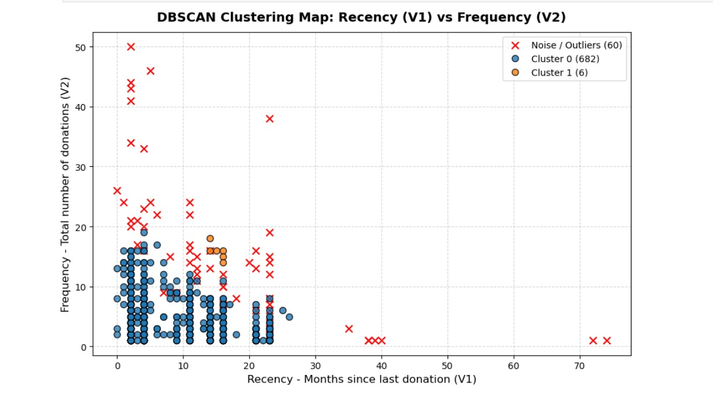
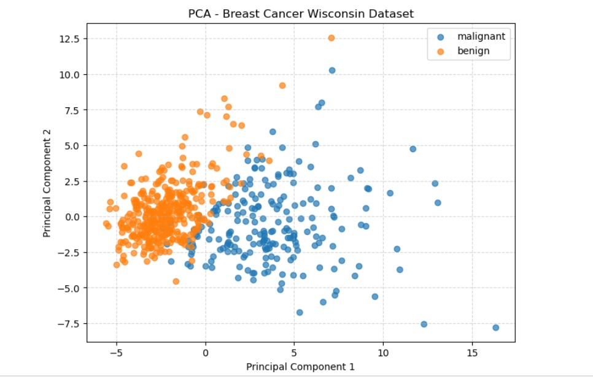

# 📊 Data Science & Machine Learning

### A hands-on collection of Python tasks, experiments, and mini-projects

Explore this repository by topic, open a notebook to see the analysis, or browse the visual gallery below. The projects cover data preparation, supervised and unsupervised learning, text analysis, and dimensionality reduction.

<p align="center">
  <a href="#-projects"><strong>Explore projects</strong></a> ·
  <a href="#-visualization-gallery"><strong>View visualizations</strong></a> ·
  <a href="#-getting-started"><strong>Get started</strong></a>
</p>

<p align="center">
  
  
  
</p>

> **Tip:** On GitHub, click a topic in the contents below to jump to its projects. Expand any **More details** section for extra context.

## 🧭 Contents

- [Projects](#-projects)
  - [Foundations and data exploration](#-foundations-and-data-exploration)
  - [Classification](#-classification)
  - [Regression](#-regression)
  - [Clustering](#-clustering)
  - [Dimensionality reduction and text](#-dimensionality-reduction-and-text)
  - [Other projects](#-other-projects)
- [Visualization gallery](#-visualization-gallery)
- [Tools and libraries](#-tools-and-libraries)
- [Getting started](#-getting-started)
- [Repository structure](#-repository-structure)

---

## 🗂 Projects

### 🧰 Foundations and data exploration

| Topic | Notebook |
|---|---|
| NumPy practice | [NUMPY TASKS](./NUMPY%20TASKS.ipynb) |
| Pandas practice | [PANDAS TASK](./PANDAS%20TASK.ipynb) |
| Matplotlib practice | [MATPLOTLIB TASKS](./MATPLOTLIB%20TASKS.ipynb) |
| Regular expressions | [REGEX TASKS](./REGEX%20TASKS.ipynb) |
| Distributions | [DISTRIBUITION_TASKS](./DISTRIBUITION_TASKS.ipynb) |
| Skewness and kurtosis | [SKEWNESS AND KURTOSIS TASKS](./SKEWNESS%20AND%20KURTOSIS%20TASKS.ipynb) · [Kurtosis exploration](./kurtosis%20EXPLORATION.ipynb) |
| Agriculture data exploration | [Indian agriculture EDA](./INDIAN%20AGRI%20EDA%20MINI%20PROJECT%201ST%20WEEK%20.ipynb) · [Dataset](./AGRI%20DATASET.csv) |

### 🎯 Classification

| Project | Notebook | Data |
|---|---|---|
| Gaussian Naive Bayes — heart data | [Open notebook](./MINI%20PROJECT%204/GAUSSIAN%20HEART.ipynb) | [heart.csv](./MINI%20PROJECT%204/heart.csv) |
| Bernoulli Naive Bayes — poetic vs. normal text | [Open notebook](./MINI%20PROJECT%205/BERNOULLI.ipynb) | [poetic_vs_normal_dataset.csv](./MINI%20PROJECT%205/poetic_vs_normal_dataset.csv) |
| Multinomial Naive Bayes — text classification | [Root notebook](./MULTINOMIAL%20MINI%20PROJECT.ipynb) · [Project notebook](./MINI%20PROJECT%203/MULTINOMIAL%20MINI%20PROJECT.ipynb) | [IMDB Dataset.csv](./MINI%20PROJECT%203/IMDB%20Dataset.csv) |
| Random forest — classification and regression | [Open notebook](./ML%20PROJECT%2012/RANDOM%20FOREST%20CLASSIIFIER%20AND%20REGRESSOR.ipynb) | [EarthquakeData.csv](./ML%20PROJECT%2012/EarthquakeData.csv) |

### 📈 Regression

| Project | Notebook | Data |
|---|---|---|
| Linear regression — sales | [Week 1](./MINI%20PROJECT%20WEEK%201/REGRESSION%20MINI%20PROJECT%20SABOO.ipynb) · [Week 2](./MINI%20PROJECT%20WEEK2/REGRESSION%20MINI%20PROJECT%20SABOO.ipynb) | [Week 1 sales](./MINI%20PROJECT%20WEEK%201/flipkart%20sales.xlsx) · [Week 2 sales](./MINI%20PROJECT%20WEEK2/flipkart%20sales.xlsx) |

### 🧩 Clustering

| Project | Notebook(s) | Data |
|---|---|---|
| K-Means and K-Medoids | [K-Means](./ML%20WEEKLY%20PROJECT%208/k-means.ipynb) · [K-Medoids](./ML%20WEEKLY%20PROJECT%208/K_Mediods.ipynb) · [Mall customer clustering](./ML%20WEEKLY%20PROJECT%208/MALL%20CUSTOMER%20CLUSTERING.ipynb) | [amazon.csv](./ML%20WEEKLY%20PROJECT%208/amazon.csv) |
| Hierarchical clustering | [Open notebook](./MINI%20project%209/hierarchialclustering.ipynb) | [malware_features_dataset.csv](./MINI%20project%209/malware_features_dataset.csv) |
| DBSCAN | [Open notebook](./Mini%20project%2010/DBSCAN.ipynb) | [blood.csv](./Mini%20project%2010/blood.csv) |

### 🧠 Dimensionality reduction and text

| Project | Notebook |
|---|---|
| Principal Component Analysis (PCA) | [Open notebook](./MINI%20PROJECT%2011/PCA.ipynb) |
| Word cloud | [Open notebook](./ml%20project%2014/WORD_CLOUD_OF_SABARISH.ipynb) |
| Web scraping | [Open notebook](./ML%20MINI%20PROJECT%2013%20WEBSCRAPPING/Sabarish_Scraping.ipynb) |

### 🌍 Other projects

| Project | Notebook | Data |
|---|---|---|
| Earthquake analysis with K-Nearest Neighbors | [KNN EARTHQUAK](./MINI%20PROJECT%206/KNN%20EARTHQUAK.ipynb) · [Python assignment](./MINI%20PROJECT%206/PYTHON%20ASSIGNMENT.ipynb) | [EarthquakeData.csv](./MINI%20PROJECT%206/EarthquakeData.csv) |
| Radial Basis Function network | [Open notebook](./mini%20project%207/RBFNETWORK.ipynb) | [COVID symptoms](./mini%20project%207/covid_symptoms_severity_prediction.csv) · [Fast food](./mini%20project%207/fastfood.csv) |
| Presentation | [Livewire project presentation](./LIVEWIRE%20ALL%20PROJECT%20PRESENTATION.pptx) | |

<details>
  <summary><strong>More details: what you'll find in this repository</strong></summary>

  - **Notebook-based work:** exercises and projects are provided as Jupyter notebooks.
  - **Data and analysis:** several projects include their accompanying CSV or spreadsheet files.
  - **Visual results:** the `images/` folder contains plots and diagrams for selected topics.
  - **A mix of topics:** examples range from foundational Python data tools to machine-learning experiments.

</details>

## 🖼 Visualization gallery

Selected images from the [`images/`](./images/) folder. Click an image to open the full-size file.

<table>
  <tr>
    <td align="center"><a href="./images/K-means%20clustering.png"><br>K-Means</a></td>
    <td align="center"><a href="./images/K-mediods%20clustering.png"><br>K-Medoids</a></td>
    <td align="center"><a href="./images/DBSCAN.jpeg"><br>DBSCAN</a></td>
  </tr>
  <tr>
    <td align="center"><a href="./images/Gaussian%20Naive%20Bayes.jpeg"><br>Gaussian Naive Bayes</a></td>
    <td align="center"><a href="./images/Multinomial%20Naive%20Bayes.jpeg"><br>Multinomial Naive Bayes</a></td>
    <td align="center"><a href="./images/PCA.jpeg"><br>PCA</a></td>
  </tr>
  <tr>
    <td align="center"><a href="./images/Simple%20Linear%20Regression.jpeg"><br>Simple linear regression</a></td>
    <td align="center"><a href="./images/Multiple%20Linear%20Regression.jpeg"><br>Multiple linear regression</a></td>
    <td align="center"><a href="./images/Word%20Cloud.jpeg"><br>Word cloud</a></td>
  </tr>
</table>

<details>
  <summary><strong>Browse more visualizations</strong></summary>

  [Agglomerative hierarchical clustering](./images/Agglomerative%20Hierarchial%20clustering.jpeg) ·
  [Divisive hierarchical clustering](./images/Divisive%20Hierarchial%20clustering.jpeg) ·
  [Bernoulli Naive Bayes](./images/Bernoulli%20Naive%20Bayes.jpeg) ·
  [K-Nearest Neighbors](./images/KNN.jpeg) ·
  [Logistic regression](./images/Logistic%20Regression.jpeg) ·
  [Gaussian heat map](./images/Gaussian%20Heat%20map.jpeg)

</details>

## 🛠 Tools and libraries

The notebooks use Python and the data science ecosystem. The exact dependencies may vary by notebook.

`Python` · `Jupyter` · `NumPy` · `Pandas` · `Matplotlib` · `Seaborn` · `scikit-learn`

## 🚀 Getting started

1. **Clone the repository**
   ```bash
   git clone https://github.com/SabarishMS123/DS-ML-TASKS.git
   cd DS-ML-TASKS
   ```
2. **Create and activate a virtual environment** (recommended).
3. **Install the packages required by the notebook you choose.** For example:
   ```bash
   python -m pip install jupyter numpy pandas matplotlib seaborn scikit-learn
   ```
4. **Start Jupyter**
   ```bash
   jupyter notebook
   ```
5. Open a notebook from the project tables above and run its cells. Some notebooks may need additional, project-specific packages or data files.

## 📁 Repository structure

```text
.
├── images/                      # Selected project visualizations
├── MINI PROJECT 3/               # Text classification
├── MINI PROJECT 4/               # Heart data classification
├── MINI PROJECT 5/               # Text classification
├── MINI PROJECT 6/               # Earthquake projects
├── MINI PROJECT 11/              # PCA
├── MINI PROJECT WEEK 1/          # Sales regression
├── MINI PROJECT WEEK2/           # Sales regression
├── ML WEEKLY PROJECT 8/           # Clustering notebooks and data
├── MINI project 9/                # Hierarchical clustering
├── Mini project 10/               # DBSCAN
├── ML MINI PROJECT 13 WEBSCRAPPING/
├── ml project 14/                 # Word cloud
├── mini project 7/                # RBF network
├── ML PROJECT 12/                 # Random forest
└── *.ipynb                        # Standalone tasks and experiments
```

---

<p align="center">
  Made with curiosity and Python by
  <a href="https://github.com/SabarishMS123"><strong>SabarishMS123</strong></a>
</p>
